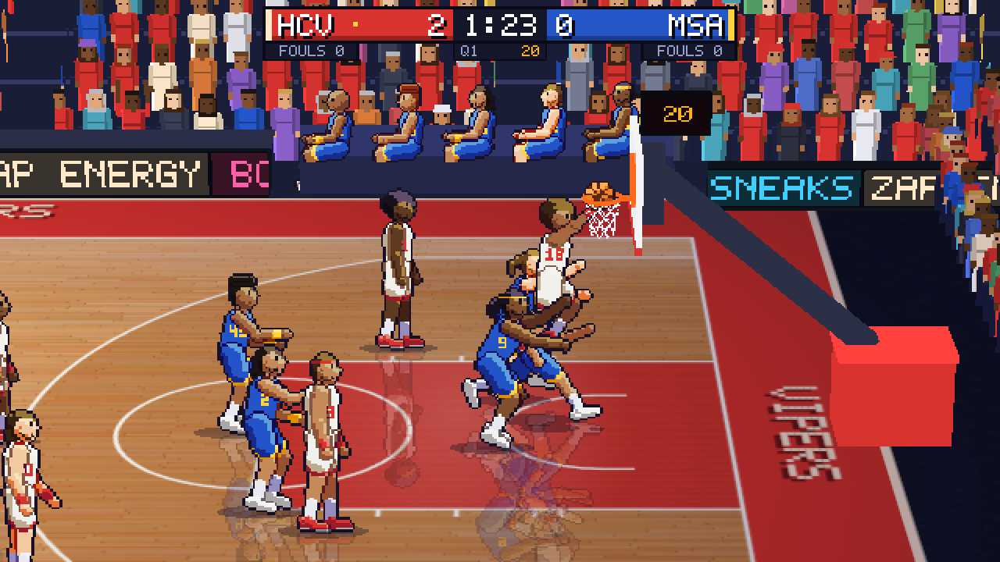

+++
title = "Projects"
description = "Side projects and experiments."
+++

## Jump Ball

An original 5-on-5 arcade basketball game for the browser, in the spirit of 8/16-bit side-view hoops games:
pixel-art sprites generated procedurally at runtime, on a low-resolution 3D court built with [three.js](https://threejs.org).

Jump Ball was an experiment with Anthropic's Claude Fable 5.2 model. The game is fully vibe-coded: the model wrote all of the code.

**[Play Jump Ball →](/games/jump-ball/)**

Play against the CPU, against a friend on the same keyboard or with gamepads, or just watch the CPU play itself.
The game needs a keyboard or gamepad, so it is best on a desktop browser.

| | Keyboard A | Keyboard B | Gamepad |
|---|---|---|---|
| Move | W A S D | Arrow keys | Left stick / D-pad |
| Pass (offense) / switch player (defense) | F | , | A |
| Shoot (offense) / steal or jump (defense) | G | . | X or B |
| Turbo | H or Left Shift | / or Right Shift | RB / RT |
| Start / pause | Space | Enter | Start |

- **Jump shot:** hold Shoot to jump and release at the top of the jump for the best accuracy.
- **Dunk / layup:** press Shoot while driving at the rim from close range.
- **Pass:** hold a direction to choose the teammate, otherwise it goes to the nearest one.
- **Defense:** Shoot steals when you are next to the ball handler, otherwise it jumps to block or rebound.
